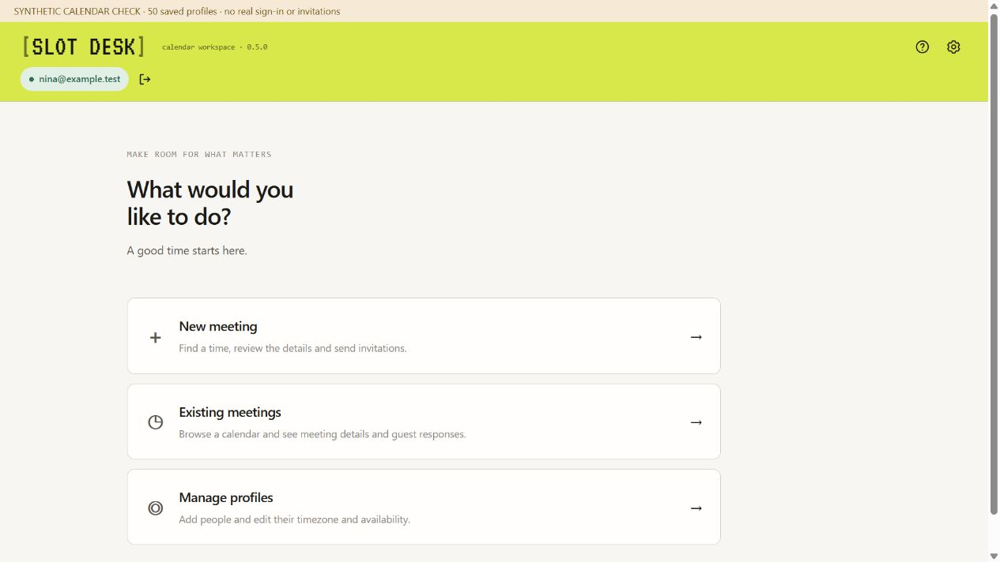

# SlotDesk design language

The supplied design kits remain the reference: [written guide](reference/DESIGN.md), [visual style guide](reference/style-guide.html), [tokens](reference/tokens.json), original CSS, sample pages, fonts and screenshots.

The [0.9.4 styling plan](../docs/styling-0.9.4.md) proposes working-interface typography, capitalization, icon/arrow and spacing standardization. The owner authorized its intermediate implementation as 0.9.3.5. The [working style guide](style-guide.html) illustrates the current type/action roles; visual approval remains with the owner and the original kit is retained unchanged.

## Wordmark and lime header

Use the actual bundled **VT323 regular 400** font for `[SLOT DESK]`, with brackets at 55% opacity and ink `#15160A`. The wordmark has no separate background box. The whole application header uses lime `#D8E84A`, including in the dark theme.

The README banner uses outlines from the supplied VT323 and IBM Plex Mono files; it does not rely on GitHub loading a custom font. A [transparent original wordmark](assets/slotdesk-wordmark.png) is retained as a reference.

## Two surfaces

The handoff/introduction follows the kit's terminal poster: lime field, square borders, VT323 display and IBM Plex Mono supporting text. The working interface follows its warm paper surface, locally bundled DM Sans body type, quiet rounded cards and semantic status colors. Pixel type is reserved for the wordmark/display surface.

| Area | Implementation |
| --- | --- |
| Wordmark | `extension/brand/wordmark.css` |
| Handoff / introduction | `extension/brand/landing.css`, `handoff.css`, `START-HERE.html` |
| Working app | `extension/prototype/styles.css`, `pilot.css` |
| Local typography | `extension/fonts/fonts.css` and supplied WOFF2 files |
| Meeting management | `extension/prototype/meeting-management.js`, `pilot.css` |

The explicit full-lime header decision supersedes the kit's neutral app header. Dark mode stays in Settings; connected email/disconnect controls form the second header row. No umbrella website brand has been selected.

## Synthetic interface examples

The [0.7.0 before/after review](../docs/assets/rescheduling-v070.png) and [overlap details](../docs/assets/overlaps-v070.png) show the current meeting-management treatment. Examples contain synthetic data, not actual calendars.

DM Sans is bundled from the [official Google Fonts source](https://github.com/google/fonts/tree/main/ofl/dmsans), with its [license](../extension/fonts/LICENSE-DM-Sans.txt). Keep the supplied [VT323 license](../extension/fonts/LICENSE-VT323.txt) and [IBM Plex Mono license](../extension/fonts/LICENSE-IBM-Plex-Mono.txt). The original reference kit remains unchanged; adaptation decisions live in [UX decisions](../docs/ux-decisions.md).
