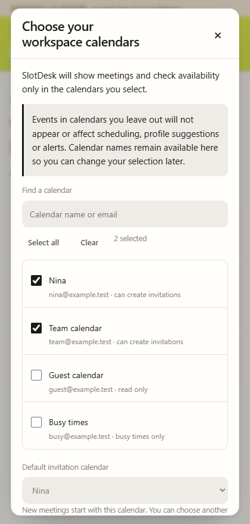

# Onboarding, profiles and calendar scope — 0.8.0

## 0.9.4.7 advanced settings

The [release contract](release-plan-0.9.4.7.md) supersedes historical flexibility and advanced-editor descriptions below. Allow overlaps now fully ignores nonprotected clashes for that person, including hidden busy periods and title guesses; explicit Protect, Assign leave, saved flights and independent profile constraints remain active. Working and convenience Ignore controls each bypass only their own rule. Manage meetings saves local treatment of an occurrence or series and does not edit the provider appointment. Blockers and detection changes save through the same account-scoped configuration and backup/import flow. Travel/flight redesign remains open.

## 0.9.4.6 onboarding hotfix — 21 October

Owner direction: calendars first, profile second, familiar people third; move the source-selection notice below calendars. Until all three steps finish, any new app session starts at step one while keeping saved entries available to prefill. Only the final Start using SlotDesk / I'll add people later action completes onboarding. This overrides the older profile-first flow.

An optional own-name hint checks at most three selected calendars, one bounded 100-event metadata page each across a 60-day window. It accepts organizer/attendee display names only when their normalized email exactly matches the connected account, ignores cancelled events/email-like values, skips busy-only sources and never requests meeting descriptions/titles for this hint. This is not Google account-profile access and adds no permission. Missing/failed hints leave a new profile name empty; a late hint never replaces typing. Name hints are not availability evidence. The user confirms the final field when continuing.

0.9.3.5 update: profile calendar editing now has separate Availability calendars and More settings expandables, fixed linked-calendar rows, explicit Add actions and no-access hiding. New profiles require explicit creation; saved invalid emails revert with a bell notice and own-profile email is locked. Explicitly deselecting calendars in Settings removes their profile links. The [validation inventory](profile-validation.md) supersedes earlier UI/save descriptions below where they differ. Non-flight advanced-section cleanup is implemented in 0.9.4.7; flight review remains.

Implemented 14 October 2026. This release covers accessible travel, main profile calendar assignments, searchable timezones, mapping-based automatic attendance, email-first guests, usual-hour convenience ignoring, participant-specific ordinary-overlap permission and workspace calendar selection. Larger settings redesign and optional LLM features remain future work.

## Three-step onboarding

1. **Choose your workspace calendars.** Search accessible calendar names/emails, select the sources SlotDesk should use and save the selection. The excluded-calendar explanation sits below the list/count. A default invitation calendar is optional and can be set separately in Settings. Without one, choose a writable organizing calendar for each new meeting. Start with relevant suggestions, not automatic access to every calendar.
2. **Set up your profile.** Confirm email, name and timezone. Only selected workspace calendars can be linked. Exact email/calendar matches can be preselected. The name may be suggested from organizer/attendee display names matching your exact email in selected calendars; it stays editable. No name is inferred from a calendar title or email address. No-access keeps availability unconfirmed. Working schedules and flexibility defaults stay in More settings.
3. **Optionally add familiar people.** Show up to six contacts from selected calendars. Confirm each person's timezone before saving; Start using SlotDesk or I'll add people later both finish setup. Keep these suggestions available in Manage profiles. Adding suggested people is optional; the final continue/skip action still completes the third step.

Existing users keep their saved profiles, mappings and pending changes, but must explicitly confirm workspace calendar scope after upgrading. They do not repeat a completed own-profile setup or optional contact step. The scope migration preserves previously selected/default/mapped sources as suggestions. No events are read before confirmation, except the exact account-bound target of an already reviewed pending operation for recovery. That exception does not allow range browsing or unrelated reads.

Onboarding saves entered values per connected account for prefilling, but all three steps must be completed to finish setup. Until then, reopening/restarting the app starts again at calendar selection and requires confirming the profile again before familiar people. The current step is deliberately session-only; saved values/profiles are not deleted. Completed users do not repeat onboarding. Closing a profile dialog leaves its step reachable. The header/close control remains fixed while forms scroll. Searchable timezone controls use real supported options, keyboard search/selection and visible error handling; arbitrary typed timezone text is not saved. The supplied local fonts, VT323 wordmark, lime header and light/dark design tokens remain.

## One workspace scope, separate profile mappings

Settings → Calendars chooses eligible sources for every event/free-busy read: browsing, profile availability, suggestions, alerts, details and reviewed writes. Calendar-list metadata remains available for identity and source selection. The selection is enforced at the transport boundary, including pagination and free/busy calls, not merely as a rendered-list filter.

The Existing meetings picker filters the memory cache inside this workspace scope. Hiding a calendar from that list does not disable its mapped availability. Date changes and Refresh load the selected workspace calendars; selection/timezone changes remain local. Scope changes clear loaded/derived data and stale reviews, and refresh an active meeting list in another window.

Profile mappings describe sources used for a person; they neither grant sharing permissions nor prove every personal commitment is known. Full coverage means the linked sources actually loaded the requested interval successfully. An excluded/inaccessible source stays in the saved profile with an inactive warning; its data is not read. Choosing no access leaves availability unconfirmed. If writable calendars remain selected, excluding the default requires an explicit writable replacement. An all-read-only selection instead keeps browsing/availability and completes setup with no invitation calendar. The calendar of an unresolved write cannot be excluded until recovery finishes. No change to scope or mappings deletes Google appointments or changes Google's underlying OAuth grant.

## Participants and unsaved email guests

A new meeting automatically includes every saved profile mapped to its organizing calendar, including multiple team members. Switching the calendar updates automatic additions while preserving manual additions, explicit removals and attendee rules. Explicitly removed people stay removed within the draft; a new meeting restores defaults. Opening/editing/rescheduling an existing appointment preserves its actual roster.

Entering an email adds the person immediately. Saved people show Edit profile; unsaved people show Create Profile and a meeting-only timezone choice. Confirm that timezone before any scheduling search. Creating a saved profile remains optional and retains the person in the draft. Unsaved guests and meeting overrides survive reload/shared-window continuation; confirmed creation or starting a new draft clears this temporary draft data.

Existing-meeting editing also adds emails without forcing profile creation. Its already fixed time can be reviewed with unconfirmed guest availability and explicit warnings. Rescheduling offers temporary timezone confirmation for the search, with profile creation optional. The final invitation list always follows explicit participant choices, regardless of conflicts or unanswered/negative RSVPs.

## Independent scheduling preferences

| Control | Effect |
| --- | --- |
| Ignore working days and hours | Keeps saved schedules but disables their day/hour enforcement; usual convenience still ranks options unless separately ignored. |
| Ignore usual convenience hours | Omits usual time-of-day comfort penalties/ties. Working-day/hour limits remain their own control; flight buffers, configured meeting radii and manual inconvenient periods still count. |
| Allow overlaps with ordinary meetings | Ignores nonprotected meeting conflicts for that person completely. Explicit Protect, Assign leave, saved flights and independently configured constraints remain active. |

Profile defaults are saved separately from Options for this meeting/search. An override affects that draft/search, not the saved person. Required/Optional attendance remains an independent choice. Existing profiles start with the two new preferences Off unless explicitly changed.

Compare effective required-person inconvenience and distance first. Among equally suitable permitted options, prefer fewer distinct affected appointments and lower disruption, then remaining comfort/attendance/time ties. A permitted daytime clash can beat a free 23:00 call when the executive still values usual convenience. Permission to overlap never implies permission to ignore late hours. Ignored overlaps do not produce scheduling warnings/follow-ups. Actionable conflicts for other people remain visible; all appointments stay in place unless separately changed after review.

## Validation and scope

The [validation record](testing.md) separates synthetic transport/browser checks from actual account reports. Creation and existing-event writers retain reviewed payloads, account/access/version checks, shared locks and same-target uncertain-result recovery. This release adds no deletion, cancellation, calendar-move, email or LLM endpoint and no new Google scope. See [security/privacy](security.md), [UX decisions](ux-decisions.md) and [changelog](changelog.md).

## 0.8.1 calendar selection and profile layout

Calendar names occupy one row with their checkbox and a separate info button. The name truncates when needed; the info dialog shows the full name, calendar email/ID, invitation capability, access, timezone and other available metadata. Selected count sits below the list.

Settings and calendar selection share a fixed popup size and fixed bottom actions. Save calendars commits the selection immediately; Discard changes, X and Escape leave it unchanged. Both return to Settings, preserving unfinished time/date display choices. A saved scope updates the Settings summary/default. The required first selection cannot be dismissed and must include at least one accessible source. A writable default is optional. Confirmed scope is reused on subsequent starts.

The own profile appears first among matching Manage profiles results and cannot be removed individually. Long emails truncate without moving/wrapping the action labels; the full value remains in the editor. Settings omits duplicate profile/suggestion actions and Appearance options. Dark mode remains the single appearance switch. Date display selects Day first (20 Oct) or Month first (Oct 20), independently of clock format. Native date inputs follow browser/OS locale; preference formatting changes generated labels and copies, not stored values, timezone calculations or writes.

## Recovery and registration in 0.9.0

The final setup step shows the five-field registration notice and optional unchecked updates choice. Skipping familiar profiles still completes registration. Existing completed users see the notice once before explicitly continuing; no automatic backfill runs. Failed submissions retain the original record locally without blocking calendar use. The private registration endpoint is configured in this preview; see [leads status](leads-table.md).

Read-only selections can finish onboarding. Proposal comparison/copying remain available, while creation asks for a writable selection in Settings. Recoverable connection failures keep saved drafts and offer reconnect without automatic sending. See the [recovery cases](recovery-experience.md).

## 0.9.1 refinement

The calendar chooser now has Save and Discard. Its default selector is removed; main Settings is the only default-calendar setting. A nonempty source selection can complete setup without a default, including read-only selections. Creating a new meeting without a usable default opens Settings for an explicit choice. Excluding the old default clears it instead of silently choosing a different calendar.

Main Settings saves display/default preferences immediately and has no fixed footer. Clear Data sits at the end of its scrollable body. Calendar selection retains its fixed footer; Save/Discard/X/Escape return to Settings. The first mandatory calendar selection still hides dismissal controls and rejects an empty selection.

Manage profiles places the count/Add toolbar above live search, five profile rows and pagination. Own profile is first among matches; Edit and Travel & flights are always vertically stacked. Familiar-person suggestions show six equal cards in two columns when narrow and three when wider. A minimal account/scope-isolated candidate cache is reused for 30 minutes after the latest entry into Manage profiles; every entry before expiry extends it. There is no manual refresh control or periodic refresh while left open. Disconnect, Clear Data and scope/access changes invalidate it. Raw fetched events remain in memory.
