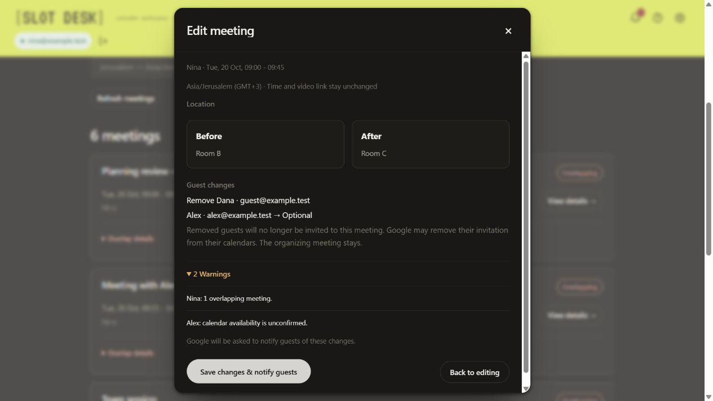

# SlotDesk validation record

Current code: **0.9.4**. Automated evidence and user-reported live behavior are recorded separately. No formal manual acceptance checklist remains.

## 0.9.4 validation

The same-version follow-up placement hotfix passes [16 focused browser assertions](../scripts/accessibility/followup-placement.js): a clear main menu, bell counts and navigation, Existing meetings placement, unavailable-calendar handling, correct replacement review, persistent dismissal and three viewport widths. All nine synthetic events remain unchanged with zero Calendar writes. The application suite below was also re-run for the hotfix.

All **1,880 application checks** pass, including 81 new ranking-policy checks. The updated regressions now expect the five-minute floor, ten-minute preference and explicit outside-hours permission. They retain the existing writer/recovery, coverage, storage, recurrence, synchronization and calendar-integrity checks. The [focused browser journey](../scripts/accessibility/ranking-0.9.4.js) passes **40 assertions** covering old-default migration, automatic/custom overrides, precise conflict types and event times, visible counts, five widths from 320 to 1280px, typed booking warnings, fresh availability recheck, creation and rescheduling.

Three axe scans (light/dark results and rescheduling review) report no automated violations. Incomplete checks and manual screen-reader/owner review remain open. Searches issue no event writes. One synthetic creation adds exactly one event while preserving all nine baseline events; the following synthetic reschedule patches only the selected event’s start/end, preserving the other eight and protected content/guests/video/reminder fields. No delete/move methods or real accounts/invitations are used.

## 0.9.3.5 validation

Application tests total 1,798, including 72 search-experience checks, 26 email/calendar-removal checks and 16 cancelled-cache regressions. Earlier unchanged backend/calendar-comparison and accessibility evidence is recorded below. See the [exact validation inventory](profile-validation.md). No live calendar writes are used. Broader visual approval remains with the owner.

## Same-version search hotfix — 19 October 2026

All 1,798 application checks and repository checks pass. The new synthetic regressions cover repeated profile edits without participant reordering, genuine organizing-calendar switches/removals, Jerusalem/Los Angeles options on 27 October, dense ordinary clashes plus an automatically detected all-day holiday, own-profile time-off warnings, preserved explicit protection/manual blocks/flights/other-profile leave, unchanged source data, holiday follow-up exclusion and deduplicated blocker reporting. Offline timezone checks cover cities/capitals, countries with multiple zones, regions without a large city, accents, common names, spelling mistakes, ambiguous abbreviations and closed-list enforcement. No personal calendar data is committed as a fixture.

The [focused browser journey](../scripts/accessibility/search-experience.js) passes 41 assertions, including participant order after live editing, city search/selection, unchanged timezone while typing, four widths from 320 to 1280px, own time-off fallback/review, a fresh booking availability check, exact blocker details and direct profile review. Three axe scans report no automated violations; incomplete checks and manual screen-reader assessment remain open. All nine synthetic baseline appointments remain unchanged, with zero POST/PATCH or unsafe methods. No real account or invitations are used. The version stays 0.9.3.5.

## Same-version meeting-loading/profile hotfix — 19 October 2026

All 1,726 application checks pass, including 16 new cache regressions: interrupted initial loads, return before cancellation settles, late old results, external aborts, completed-cache reuse and restored completeness. The focused [browser journey](../scripts/accessibility/meeting-loading.js) passes 29 assertions: leave/return recovery, stopping during the preliminary account check or event loading, exact warning copy and placement, inline refresh, cached completed returns, five widths from 320 to 1280px, quiet live saves for own/other profiles, invalid-time protection and a simulated full-storage failure/retry. Both focused light/dark axe scans report no automated violations; automated incomplete checks still require manual assessment. All nine synthetic appointments remain unchanged; there are no event writes. The version stays 0.9.3.5.

## Same-version capitalization hotfix — 19 October 2026

Reviewed all shipped HTML pages and production JavaScript, including generated labels, alerts, tooltips, accessibility instructions and copied proposal text. Remaining capitals identify sentence starts, named controls, proper names, acronyms, timezone/date data, user content or deliberate robotic accents. The working style guide no longer permits title-case profile headings.

All 1,710 application checks and repository checks pass. The existing profile browser journey passes 37 assertions with the corrected headings. Twelve focused synthetic-browser checks cover meeting details, calendar tooltip/accessibility text, real one-/two-warning summaries, all five bundled HTML pages, Help action references, onboarding privacy copy and the manifest name. No calendar creates, patches or alterations occurred. This is a 0.9.3.5 hotfix; owner UX approval remains open.

## Same-version interface follow-up — 18 October 2026

The participant-card follow-up also passed 28 focused browser assertions: compact name/email/timezone placement, connected and crossed-out calendar icons, the exact hover/focus wording, Escape dismissal, linked-calendar automatic-participant guidance, meeting-only copy, and six widths from 320 to 1280 pixels. Automated accessibility scans showed no violations in either theme after transitions completed. Synthetic appointments remained unchanged.

Verified participant suggestions opening before typing, filtering, outside-click dismissal, reopening after dismissal, page-scroll dismissal, internal-list scrolling and keyboard selection. Checked Add/search alignment and horizontal overflow at 320, 390, 514, 600, 680 and 1280 pixels, plus dark-theme behavior in a short viewport and the generic Edit Profile heading. Suggestions fit the available space above or below the field and remain below the header. Re-ran the existing 20 accessibility screen states and 36 keyboard/focus/reflow assertions with no automated violations. Application checks and repository checks pass; synthetic appointments remain unchanged. Version stays 0.9.3; the overall UX remains open for owner review.

## Reported live progress — 13 October 2026

The owner reports:

- The No response from the existing invited guest appeared as an alert.
- Replacement-time suggestions made sense.
- An actual reschedule completed successfully.
- Overlapping labels appeared and their details were correct.

This report covers the behavior actually observed. It does not independently verify recipient update delivery, recurring/all-day live changes or post-reschedule integrity across the entire calendar. Other edge cases currently have source/automated coverage; they are not labeled live-tested.

## Automated checks

From the repository root:

```sh
npm test
npm run test:backend
npm run test:calendar-kit
npm run check
```

| Suite | Checks | Scope |
| --- | --- | --- |
| Configuration/files/flights | 120 | Portable settings/constraints, own-profile rules, named-column compatibility, DST and failed/interrupted replacement |
| Engine | 47 | Core scheduling semantics |
| Regression | 90 | Constraints, optional guests, travel, comfort and fallback rules |
| Calendar pilot | 78 | Profiles, timezone handling and reader normalization |
| Booking | 70 | Reviewed new invitations and duplicate-safe recovery |
| Safety/scale | 69 | Account isolation, write guards, dense reads and unchanged unrelated meetings |
| Proposal display | 76 | Date/year/DST formatting, coverage and consolidated warnings |
| Calendar view | 42 | Date ranges, events, RSVP display and source handling |
| Upgrade/synchronization | 71 | Stored-state migration and concurrent-window behavior |
| Multi-calendar cache | 64 | All-source reads, cached filters, partial coverage and interrupted-load recovery |
| Meeting management | 457 | Overlap oracle, No transitions, identities and follow-up metadata |
| Rescheduling | 112 | Time-only conditional writes, permissions, identity/version and recovery |
| Meeting editing | 125 | Narrow detail/guest writes, preserved metadata, stale/permission guards and recovery |
| Onboarding/scope/guests/flexibility | 71 | Selected-source transports, migration/recovery, draft guests and independent scheduling rules |
| Recovery/registration | 68 | Typed outcomes, quota, cancellation, stale/access loss, read-only setup, exact leads, manual history and collision evidence |
| Interface state | 140 | Profile pagination, sliding candidate cache, offline scheduling/backoff and provider retry pauses |
| **Application total** | **1,684** | Synthetic data and transports |
| Export comparator | 22 | Offline creation/export integrity comparison |

The 112 rescheduling, 70 booking and 69 safety checks were rerun after the latest live report: **251 passed**, with no real Google request or invitation. All source network entry points were reread; see the [write-boundary record](security.md#focused-calendar-write-recheck--13-october-2026).

## Synthetic browser evidence

### 0.9.1 connection confirmation and responsive polish

Local mocked browser checks covered 320/390/680/1200-pixel layouts, constant wordmark/header dimensions, no horizontal overflow, equal two-/three-column suggestion grids, stacked profile actions, five-row pagination, search across all 50 profiles, cached re-entry, Settings auto-save, identical Settings/calendar dimensions, Save/Discard semantics and closed-on-entry participant selection with Escape. Offline/online events blocked and restored New meeting.

Lost replies after a saved create, detail edit and reschedule produced pending bell alerts, then automatic success without another POST/PATCH. A creation that was not applied became a verified failure with Try again after repeated reads. A second failed retry restarted the loop with the same event ID; the final explicit retry produced exactly one appointment. Reopen/online checks resumed without new writes, a verified-unsaved discard read the target before clearing its local request, and a permanent access failure offered contextual review without a send retry. Detail-edit recovery preserved untouched times, description, location, guests, video, attachments and reminders. Rescheduling recovery preserved untouched meeting fields. The transport rejected unsupported methods; no real account was used.


### 0.8.1 settings and calendar polish

Local synthetic browser checks verified sidebar calendar rows/count, metadata dialog, fixed footer under scrolling, identical Settings/calendar bounds, save and discard returning to Settings, retained unsaved date choice, removed duplicate actions and own-profile-first/removal protection. First setup hides close/discard, blocks Escape and refuses empty selection; valid scope continues to optional people. Date-order checks include both orders, AM/PM, midnight, future-year rollover and warning/copy labels. Long identity and calendar names are checked for truncation without horizontal overflow. No real Google account, invitation or event mutation is used.


### 0.8.0 onboarding and profiles

The focused local fixture exercised own-profile-first setup, searched timezone choice, explicit calendar scope/default, optional familiar-person skip, main calendar mappings, direct focused travel access, multiple profiles on a team source, saved defaults/per-meeting overrides, manual additions/removals during calendar switches, unsaved email guests, mandatory timezone confirmation and reload continuation. No event reads occurred before scope confirmation; excluded guest/busy sources were not requested.

One reviewed synthetic invitation was created in the chosen team calendar for exactly Alpha, Nina and the unsaved email guest. All eight original appointments remained unchanged; zero PATCH, DELETE, full replacement or move requests occurred. A second open workspace cleared an excluded team's events, refreshed the remaining source and preserved inactive profile mappings. Existing-meeting guest addition reached review without forcing a saved profile. Rescheduling blocked source reads until an unsaved guest’s timezone was confirmed, then produced options without saving a profile or writing a change. An isolated upgrade fixture preserved all 50 saved profiles and excluded mappings, with zero event reads before explicit scope confirmation. A final fresh setup produced no phantom draft, and a second synthetic booking cleared temporary guests and meeting rules after completion. Across both bookings, two insertions and no existing-event mutations were recorded; all eight originals remained unchanged. No real account, message or invitation is involved.


The 0.7.1 fixture used 50 saved profiles and eight original appointments. It exercised searchable guest selection, short profile setup for a new email, Required/Optional changes, explicit guest removal, field comparison, known-conflict/unconfirmed warnings and a combined details/guest save. One event changed; seven unrelated appointments, its times and protected metadata remained unchanged. Retained RSVP values survived and a newly added guest had needsAction status.

A second title-only edit deliberately lost both the PATCH response and initial readback. Reload recovered the saved intent by reading the same ID, without another PATCH. The other open window updated its cached title through an ID-only completion notification. Across these flows, the fixture recorded two PATCH requests, zero insertions and zero deletion/full-replacement/move requests. No Google account or real invitation was used. These editing flows have not been labeled live-tested. At 420px the review had no horizontal overflow and retained a visible fixed heading/close control.



### Earlier 0.7.0 browser evidence

The 0.7.0 browser fixture used 50 profiles and eight original appointments. It exercised alerts/dismissal, missing profiles, overlap details, OTHER-appointment planning, all-day dates, a single recurring occurrence, concurrency and reload recovery.

The main fixture made six time-only PATCH requests across four explicitly selected original appointments and one new-event insertion. It made zero delete/full-replacement/calendar-move requests. Selected non-time fields and the other four original appointments remained unchanged, including a neighboring recurring occurrence. Concurrent confirmations produced one PATCH. A separate lost-response fixture recovered the same event after reload with one PATCH and no duplicate write. These are mocked outcomes, not observations of a real Google account.

At 420px, date inputs remained on one row, heading/close stayed fixed, and the VT323 wordmark used the full lime header without horizontal overflow.


[Synthetic before/after review](assets/rescheduling-v070.png).

Earlier fixtures covered 6,000 paginated events, 2,000 unchanged unrelated meetings, 54-calendar browsing, cached filtering and multiple-window synchronization. Recorded product releases retain their historical validation counts in the [changelog](changelog.md).

## Previously recorded live evidence

- The initial dense-calendar comparison independently preserved all **1,013 original components**, with exactly one new event and the expected own-profile attendee, time and Meet link.
- Delivery of invitation 02 and visible Yes/No responses were reported by the owner.
- The older stale-window protection behaved as expected by user report; newer synchronization has synthetic coverage.

No post-reschedule export has been supplied. The initial creation comparison is not relabeled as evidence for later writes. Calendar exports and private evidence stay outside Git. The [optional offline comparison kit](calendar-acceptance.md) remains available for reproducing integrity analysis, without a required user checklist.

## Source and package evidence

The standalone migration passed syntax/link/asset/manifest checks and all application/comparator suites. A fresh checkout reproduced the existing 0.7.0 ZIP exactly, preserving the extension/OAuth identity and fonts. [Migration record](migration.md).

The focused source review and synthetic outcomes are not a guarantee against every future bug or browser/account condition. They establish the current explicit write boundaries and tested cases; work-account access remains subject to organization permissions.


## 0.9.0 preview verification — 15 October

All 1,420 application checks, six server-intake test cases and 22 export-comparison checks passed. Focused mocked browser checks at 390 px verified read-only onboarding, both optional update choices, registration payload/status, stale meeting retention, access-loss purging, same-account reconnection, read-only Check result, acknowledged manual resolution/history and corrupt-storage preservation. Transport statistics showed zero calendar POST/PATCH/delete/move calls in these recovery/setup checks and eight original events unchanged. Expected injected HTTP failures and the fixture favicon were distinguished from application exceptions; the missing read-only explanation element found during the check was fixed before completion.

The private database schema has exactly five columns, and SQL privilege inspection confirms the intake role can INSERT but cannot SELECT, UPDATE or DELETE. Server handler tests use synthetic inputs. The service is deployed and the preview is configured. Public HTTPS checks returned 204 for the allowed preflight, 400 for invalid input, 403 for another origin and 405 for reads. The actual API entrypoint and Neon driver accepted initial and duplicate submissions through a local HTTP bridge on an isolated Neon branch; owner readback confirmed the first five-field record was unchanged. The production table received no test contacts. The first real submission from the updated extension remains to be observed. See [deployment evidence](registration-deployment.md).

## 0.9.2 local browser evidence — 18 October

Synthetic Google transport only: valid profile text/checkbox changes saved live; invalid email and simulated full storage preserved the saved value and entered text. Two windows retained unrelated field edits. Flight forms ignored Escape and exposed no X, saved an outbound/return pair, and Discard preserved the saved list. Profile files exported/imported, replacement warnings appeared, and full restore cleared the unsent meeting while preserving own-profile identity and recipient registration. The other window closed its stale editor. Configuration flows made zero event POST/PATCH/DELETE requests. Narrow/wide layout and keyboard/onboarding checks use this same fixture. No new real-calendar checklist is required.

## 0.9.3 accessibility evidence

The [accessibility record](accessibility.md) and [structured report](accessibility-results.json) document 20 zero-violation automated screen scans and 36 browser journey assertions. All 1,684 application checks are retained. This technical result does not certify complete accessibility or close the owner’s overall UX review.
