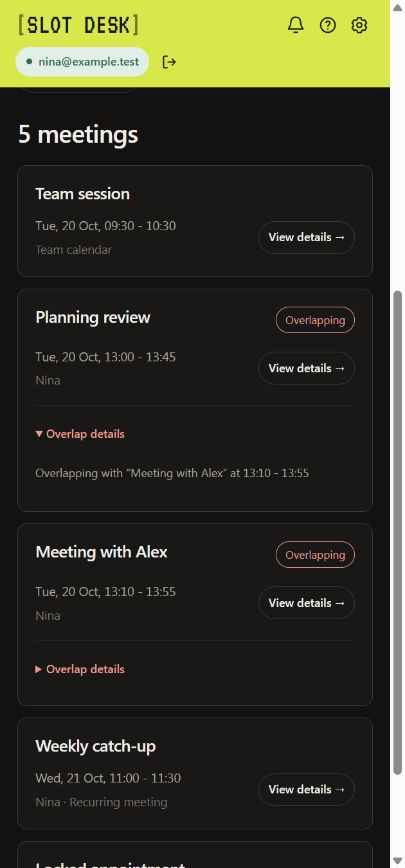

# SlotDesk validation and live acceptance

## Release 0.7.0 evidence

1146 application checks and 22 export-comparison checks pass. The new overlap suite compares the interval index against a brute-force oracle for 200 varied entries; new rescheduling tests exercise conditional time-only updates, preserved fields, stale versions, revoked roles, identity changes, lost responses, concurrent operations, recurring instances and all-day dates. Previous dense-reader/creation integrity coverage remains.

A local synthetic browser fixture used 50 saved profiles and eight original meetings across multiple calendars. It verified No alerts with optional context; simple overlap details on meetings created elsewhere; escaped written content; fresh replacement search and missing-profile warnings; an exact single-occurrence change; an all-day date-only change; and opening the OTHER conflicting event with a protected interval. Selected writes retained all non-time fields and left unselected original events unchanged. The fixture made no real Google request or invitation. Screenshots and final transport counts are recorded below.

The final fixture transport recorded six time-only PATCH requests across four explicitly selected original appointments, one separate new-event POST for the creation regression check, zero DELETE/PUT/calendar-move requests, all non-time original content unchanged and the other four original appointments unchanged. The neighboring recurring occurrence was among those untouched originals. Two simultaneous confirmations produced one PATCH; a later second-window check added no duplicate update. A confirmed collision created a saved follow-up without moving the other meeting; resolving that follow-up removed it. Locked appointments kept Send disabled while permitting a copied time. Missing timezone setup opened the short profile editor without assuming a timezone. No console errors were observed.

An isolated recovery fixture deliberately applied a conflicting time change, lost its response and failed the immediate readback. After reloading, Review unfinished change confirmed the same appointment without another PATCH and retained the OTHER appointment's follow-up. That fixture recorded one PATCH, zero insert/delete/move operations, all non-time content preserved and the other seven original meetings unchanged. Pending conflict metadata stores only IDs and protected intervals; multiple new intervals for the same affected appointment are combined.

At 420px the date inputs remained on one row, the document and dialog body had no horizontal overflow, the wordmark used VT323 and the header measured `rgb(216,232,74)`. Review started at the top of its scrollable body and retained the fixed heading/close button.

[Before/after rescheduling review](assets/rescheduling-v070.png).

The new existing-event mutation path has focused verification, not a new exhaustive audit or live work-account clearance. Live invitation updates and real recurrence/content preservation still require the [focused acceptance session](combined-live-check.md#test-1-rescheduling-alerts-and-overlaps).

## Release 0.6.1 evidence

577 automated checks pass, including 48 new multi-calendar cache checks. The calendar-view range test now accepts a long span instead of expecting the obsolete 93-day rejection. The 22 standalone export-comparison checks remain separate. Cache tests cover all-source loading, local selection/timezone filtering, account separation, clearing/stale results, progressive/error states, busy-only access, own-event upsert and complete pagination beyond 100 pages while retaining loop detection.

A synthetic browser fixture used 54 calendars. Initial browsing read 53 event calendars and one free/busy source; two separate contact-suggestion reads are excluded from that browse total. Adding/removing selections and changing timezone added zero reads. Changing the end date to a year later added another complete 54-source load; Refresh added exactly another complete load. A 2027 meeting appeared after pagination. At 420px the start/end inputs had identical vertical positions and no horizontal overflow. Multiple calendar names appeared on cards and the detail popup retained the correct source. Cached busy-only and forbidden-read states were explicit; deselecting the failed calendar removed its warning without a fetch. Disconnect cleared the cache/list in both surfaces. No event insert/update/delete was made in these checks.

## Release 0.6.0 evidence

529 automated checks pass (47 engine, 90 regression, 78 pilot, 70 booking, 69 safety/scale, 66 proposal display, 42 calendar view and 67 upgrade). The 22 standalone export-comparison checks also pass. Obsolete grid/fixed-empty-group assertions were replaced by the explicit boundary/result-only contracts.

Focused localhost browser checks used synthetic calendars and 50 saved profiles, with no real login/invitations: automatic second/third-window session adoption; unchanged review validity just from opening another surface; profile propagation and same-name edit conflict choice; native mapping dropdown duplicate prevention and secondary-owner suggestions; whole-week/Past browsing; readable own-profile organizer/guest names; escaped long description and fixed popup close control at 420px; title/time/review persistence and required recheck; clock/theme propagation; two concurrent sends yielding one POST/event and zero update/delete requests; shared disconnect closing/clearing review surfaces. No console errors were observed in the checked windows.

These synthetic outcomes do not complete the real shared/revoked permission session or grant work-account clearance. [The updated live checklist](combined-live-check.md) avoids repeating the completed invitation and adapts the old stale-window check to the new UX.

Current release: **0.7.0**. Keep automated/mock outcomes separate from user-reported live outcomes and workplace approval.

## Automated checks

From the repository root:

~~~sh
npm test
npm run check
npm run package:slotdesk
~~~

| Suite | Checks | Scope |
| --- | --- | --- |
| Engine | 47 | Original scheduling behavior |
| Regression | 90 | F01–F14, constraints, fallback, timing and normalization |
| Calendar pilot | 78 | Reader, OAuth configuration, profile/storage and input contracts |
| Booking/UX | 70 | Email identity, work rules, clocks, attendee payloads, writing and uncertain-send recovery |
| Safety | 69 | Explicit participant selection, shared-calendar RSVP, payload/account/storage guards, competing sends and dense calendars |
| Proposal display | 66 | Conditional years, midnight/DST/zone offsets, calendar confidence, participant fit and warning consolidation |
| Calendar view | 42 | Range/DST boundaries, all-day filtering, transparent/declined entries, invalid dates, origin markers, guest responses and onboarding migration |
| Release upgrade | 67 | Closest boundaries, weeks, mapping, partial invitations and synchronized storage commits |
| Multi-calendar cache | 48 | Unrestricted ranges, all-source cache, local filters, complete pagination and stale/failed reads |
| Meeting management | 457 | Overlap oracle/deduplication, No transitions/dismissal, occurrence exclusion, disruption counts and pending storage |
| Rescheduling safety | 112 | Exact time-only PATCH, stale version/identity, roles, lost responses, retry/timeout, preserved fields and recurrence |
| Total | 1146 | Synthetic data and mocked Google responses |

The repository check validates JavaScript syntax, current local documentation links, HTML/CSS assets and manifest/version consistency. Packaging produces a reproducible ZIP without source tests or repository docs. Archived documents preserve historical references.

## Version 0.5.0 browser evidence

A loopback-only browser check used synthetic identity and Google responses. Existing configured storage opened at the home menu; fresh setup completed the own-profile/default-calendar/familiar-faces flow, including optional profile creation. A 50-profile workspace supported name search and editing. The meeting browser loaded 60 same-day entries, rendered the first 50, then showed the remaining 10; all-day/free/declined entries and a verified SlotDesk tag were visible. Guest responses and optional status appeared in details. Raw description markup remained literal text with no executable image element.

Busy-only access showed availability and the missing-detail explanation. Unreadable dates and revoked access showed incomplete data without falsely claiming an empty calendar. A synthetic new event passed fresh checks, showed Meeting created and returned to the home menu; browsing then showed its origin tag. The fixture recorded one new-event insertion, with no update/delete/move operation. Disconnect cleared meeting rows/details, calendar choices, account text and open dialogs.

In a 390px panel, scrolling the long meeting description changed body scrollTop from 0 to about 1,645px while heading/close positions stayed fixed at about 15px/35px. The home menu and confirmation had no horizontal overflow. The [light workspace example](assets/workspace-menu-light.png) uses synthetic data. No real sign-in or invitation was performed by the agent. This does not complete the three pending live sessions.

## Version 0.4.0 evidence

The safety suite reads **6,000 synthetic events over three pages**, checks a six-participant dense scheduling request, and compares **2,000 existing synthetic meetings** before and after new-event/recovery operations. Existing objects remain unchanged. It checks rejected cancellation/recurrence fields before token/network access, request snapshots, lost responses, duplicate/collision handling, account namespaces, omitted fetched-event/token persistence, stale storage revisions and competing send locks. The dense seven-day search took approximately **0.46 seconds on the development machine**; this is a measured fixture result, not a general performance guarantee.

A focused local browser check used fake identity and calendar responses routed only to a loopback server. It checked:

- 50 saved profiles with no initial attendees, name/email search, explicit addition of the own profile, searchable management, and New meeting clearing selections while retaining profiles.
- The dark-mode switch, light/dark design and 390px panel layout.
- Search, review, account/write safeguards and one simulated creation with expected attendees and a delegated organizing calendar.
- A hostile-looking event title rendered as text, with no injected image, script or dialog.
- Disconnect closing editors and clearing event/profile/review text; reconnect restoring saved selections/preferences.

No real Google sign-in or invitation was performed by this check. The current screenshots are maintained with each UI release and use synthetic data. Review boundaries and remaining uncertainty are documented in [security/privacy](security.md).

## Version 0.4.1 UI validation

The header/settings/help change uses the same scheduling and calendar-write paths as 0.4.0. A focused synthetic browser check passed at 390px and 320px: the connected header stayed at two rows (about 95px/91px), a long email truncated without horizontal overflow, and the complete account address remained accessible. Help/Settings/Disconnect labels, settings-only dark mode/full-workspace controls, appearance toggle/save persistence, Help before/after disconnect and the linked privacy notice passed. Help/privacy pages retained the saved dark appearance. The existing 354 checks passed; no new calendar write operation was introduced. No real sign-in or invitation was performed.

## Version 0.4.2 display validation

Forty additional checks pass for the requested compact heading, future-year inclusion and automatic year rollover, 24-hour/AM-PM display, midnight/year boundaries, fractional GMT offsets, DST changes, known conflicts, missing required/optional calendar data, profile-rule mismatches and inconvenience minutes. The scheduling decision rules and Calendar writer are unchanged; the engine exposes existing fit reasons/counts for display. The app now totals 394 checks; the separate calendar export comparator retains its 22 checks.

A focused local browser check at 390px verified the exact requested heading/subtitle, no repeated local date/time for the same-zone participant, compact times for a different-zone guest, missing optional calendar data and known optional conflicts. It also checked compact local times in the review without creating an event. No real sign-in or invitation occurred.

## Version 0.4.3 warning validation

The warning checks cover one shared conflict across two participants, two distinct appointments with identical titles, optional conflicts, incomplete calendar access with its error details, profile rules, inconvenience, preserved calendar notes and unchanged source slot data. All 420 application checks passed.

## Live checks and project-owner reports

On 12 October 2026, the owner reported that the previously described basic live connection/setup/search/booking steps work, including the invitation/Meet flow. This is user-reported evidence; the agent did not independently inspect the live event or recipient delivery. Account type, optional-status checks, delegated permission level and dense-calendar behavior were not fully recorded.

The owner imported the synthetic fixture and supplied a single-calendar Google export on 12 October 2026. Local inspection verified 1,013 expected event identities, zero missing/unexpected entries, the recurring rules/exclusion and transparent free-window note. The owner then reported that the expected 20 October 2026 13:00–13:45 Israel-time proposal appeared. The untouched export remains outside Git; it uses a Europe/London timezone header. A subsequent single-calendar export on the same date passed the local before/after comparison: 1,013 original event components remain unchanged, zero deletions or changed event contents, unchanged timezone definitions, and exactly one addition (1,014 total). The new confirmed event matches 20 October 2026 13:00–13:45 Asia/Jerusalem, contains only the owner’s profile as an attendee, and includes one distinct Google Meet link. Its identifier matches the SlotDesk stable event-ID format. The owner performed the live actions in regular Chrome; the agent inspected the supplied exports offline. The installed extension version was not separately recorded. Recipient delivery and RSVP behavior are not established by this export. Both raw exports, receipts and the comparison report remain outside Git.

Nina's work provider is **Google Workspace / Google Calendar**. Outlook support does not block her pilot. These synthetic checks do not complete clearance to connect her work account: the [work-account gate](security.md#work-account-gate) remains open.

### Remaining invitation session: owner report on 12 October 2026

The owner reports that the test recipient was successfully invited, the owner's own **Yes** response is visible, and the recipient's **No** response has subsequently been recorded. This establishes reported Yes/No display progress, not independent inspection or a complete RSVP scheduling session. Maybe response display, participant-specific accepted/tentative/declined scheduling behavior, optional status, exact meeting time and Meet details have not all been separately verified in this update. The final comparison against the 1,014-event export is still pending.

The owner also reports that the two-window/stale-send/reconnect session behaved as expected. Record that session as user-reported PASS; a fresh export has not yet independently checked for a probe event. Disconnect/reconnect is now a rejected normal UX, with automatic same-account synchronization implemented in 0.6.0 as recorded in the [pending UX review](pending-ux-review.md#panel-and-full-workspace-synchronization). Shared/read-only/revoked/restored permissions still need a second account. The 0.7.0 consolidated checklist also requires updated synchronization and rescheduling acceptance. The unreported RSVP edge cases should remain pending for targeted checks rather than be marked passed. The current consolidated checklist is three sessions and one final export.

## Busy real-calendar acceptance — integrity check passed; live behavior pending

The [combined live checklist](combined-live-check.md) collects the three remaining manual sessions and their result sheet in one run. It reuses the delivered invitation, confirms two selected time changes and requires one final export; permission/window probes must not create events. Preparing the recipe does not mark these checks complete.

Use the [disposable-calendar acceptance kit](calendar-acceptance.md) to generate 1,013 synthetic event components and compare Google exports before/after reviewed creations. Its 22 standalone comparison checks passed. Generation and comparison happen locally. The fixture import/baseline, expected live search, self-only creation and first after-export integrity comparison are complete. The export confirms the first meeting's expected time and Meet link. The later invitation/Yes/No display and two-window session have user-reported results; shared/read-only/revoked permissions remain to be tested, along with unreported RSVP edge cases and the final export comparison. Workplace approval is a separate requirement for Nina. Current source/application release: 0.7.0; the installed build for the first export was not separately confirmed.

First use an approved personal/pilot account with a disposable test calendar and consenting participants. Populate it densely with synthetic appointments; do not use private work-calendar exports as fixtures.

1. Record the build and account/calendar permission level. Inspect Calendar before and after each test without saving private event details in Git.
2. Include ordinary, overlapping, recurring, all-day leave, holiday, declined/tentative and transparent events, plus DST/cross-midnight scenarios. Test shared-calendar owner RSVP separately from the assistant's RSVP.
3. Confirm profiles and mappings. Check known free/busy periods, full participant-local dates/times and unconfirmed coverage against Google Calendar.
4. Review/copy an invitation and send only to consenting test recipients. Check organizing calendar, recipient/optional flags, duration, location, Meet and delivery. Edit time/attendees and confirm a recheck is required.
5. Compare unrelated meetings before/after: identifiers, content, times, attendees and recurrence must remain unchanged. Avoid deliberately interrupting a non-test booking.
6. Exercise reconnect, revoked sharing, partial/failed reads and full-tab/side-panel use. A stale window must stop sending. If a test send genuinely becomes uncertain, recover the same event and verify one copy.
7. Record outcomes/failures without publishing names, descriptions or tokens. Only then confirm workplace approval and connect Nina's work account for controlled acceptance.

## Historical validation

Version 0.3.0 passed 285 automated checks and a broader mocked browser flow for onboarding, work rules, suggestions, review, copy, simulated booking, lost-response recovery and formatting. Versions 0.3.1–0.3.3 corrected fonts/style/header. Version 0.3.4 integrated the repository and passed package/source integrity checks. Version 0.3.5 passed 285 checks and focused timezone-markup validation. These do not establish the remaining busy-calendar or organization acceptance. See the [product changelog](changelog.md) and [migration record](migration.md).
